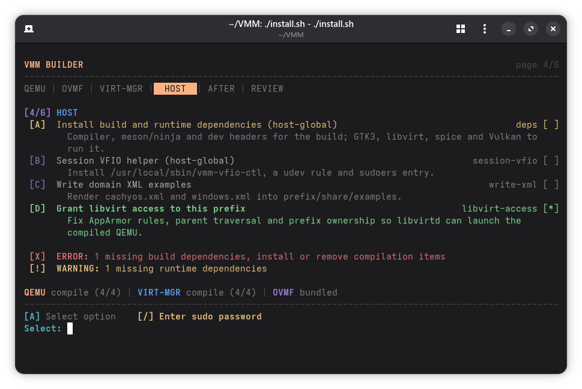
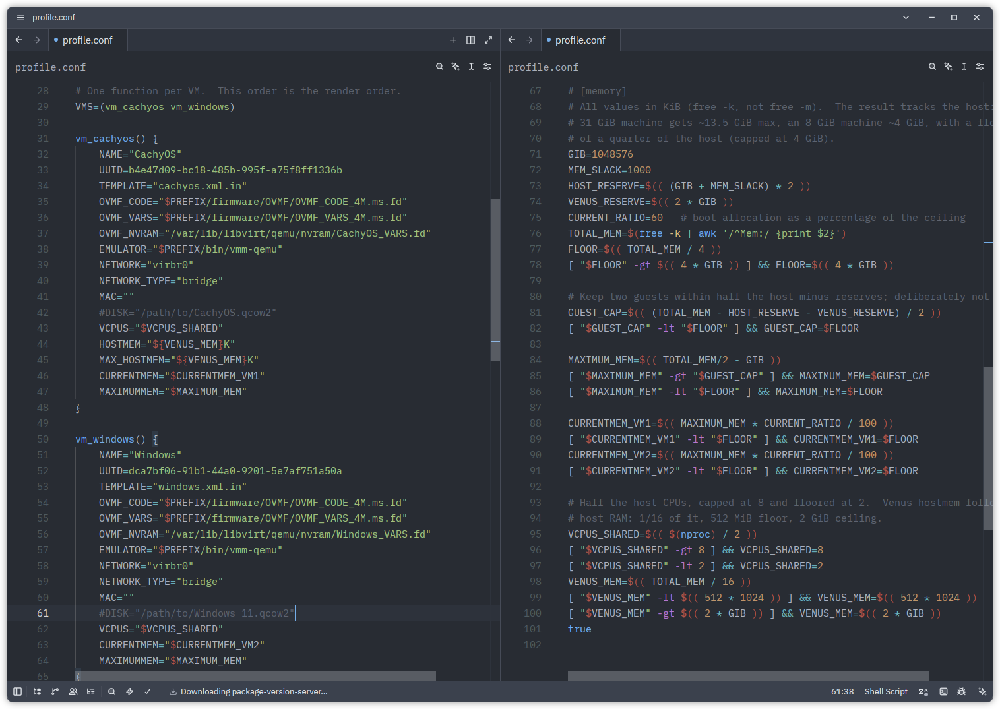
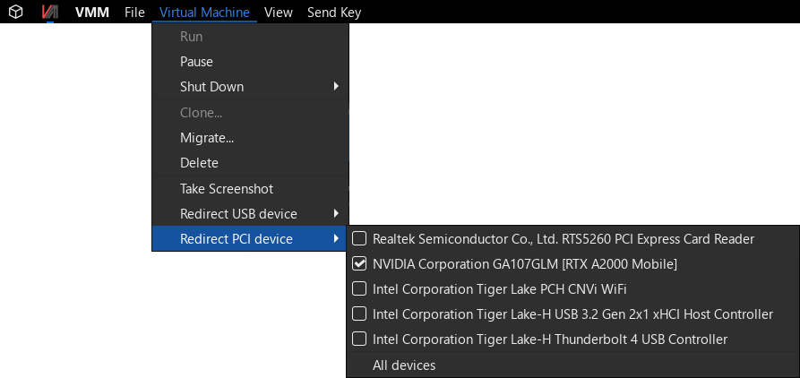
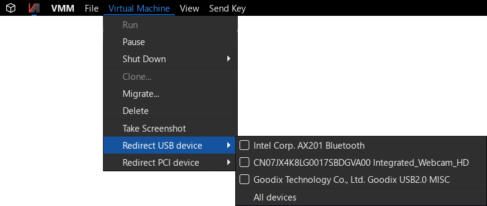
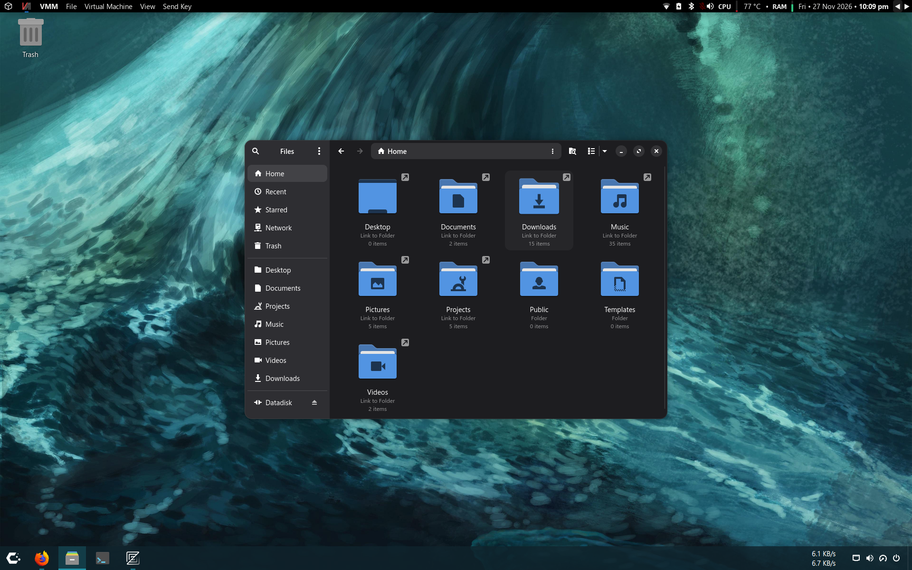
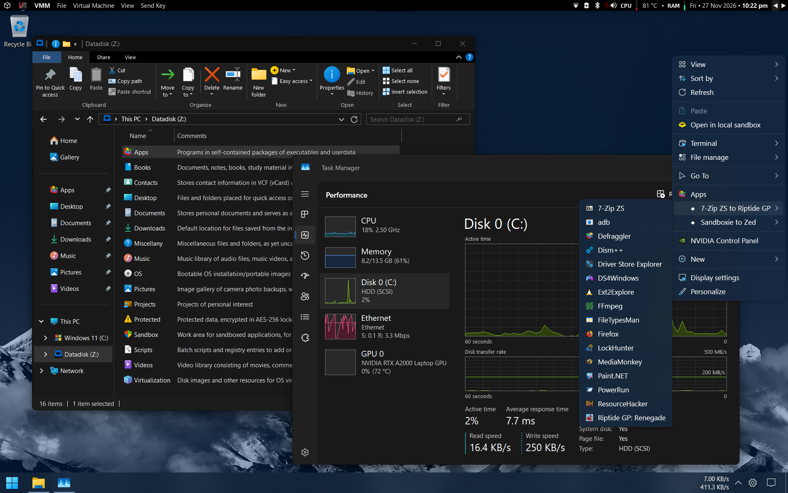

<p align="center"></p>
<h1 align="center">VMM</h1>
<p align="center">A portable Virtual Machine Manager with hand-curated patches for usability (PCI/USB hotplug menus), 3D (VMware SVGA/DXVK on Windows, <code>virtio-vga-gl</code>/venus on CachyOS, SPICE + GTK together) and appearance (silent OVMF boot, a seamless X11/XWayland-reparented console).</p>

---

## Screens

<table>
  <tr>
    <td width="50%"><br><b>Installer TUI</b>: six pages (QEMU, OVMF, virt-manager, HOST, AFTER, REVIEW). Missing build dependencies show a persistent error; sudo-gated rows ask once through sudo's own prompt. Runs in a PTY or a bare Linux TTY (e.g. <code>Ctrl+Alt+F3</code>).</td>
    <td width="50%"><br><b>Dynamic profile</b>: memory ceiling, boot allocation, vCPU count and venus hostmem are computed from the host. Blank fields are filled back from the live domain on sync.</td>
  </tr>
  <tr>
    <td><br><b>PCIe hotplug</b>: a curated submenu that hides boot displays and mounted filesystems; here only the RTX A2000 is pre-selected.</td>
    <td><br><b>USB hotplug</b>: a submenu backed by a device cache; Bluetooth, webcam and Goodix devices are listed for redirection for live attachment to the guest.</td>
  </tr>
  <tr>
    <td colspan="2"><b>Note on the menu bar</b>: the top bar is the Debian host's XFCE global-menu applet showing virt-manager's menus (File, Virtual Machine, View, Send Key). The window is maximized with its titlebar hidden by XFCE</td>
  </tr>
  <tr>
    <td colspan="2"><br><b>CachyOS</b> — virtio-vga-gl with venus/blob globals, dynamic hostmem and a GL console reparented into the detail window.</td>
  </tr>
  <tr>
    <td colspan="2"><br><b>Windows 11</b> — VMware SVGA 3D with DXVK, host-driven resolution and SPICE channels kept for USB and the agent. Portabilized app collection from <a href="https://github.com/808x/portable-apps">808x/portable-apps</a> in context menu.</td>
  </tr>
</table>

---

## What it is

VMM is not a disk image and not a distro. It is **source plus patches**: a set of pinned upstream checkouts, an additive patch series, and a small installer that assembles them into a relocatable prefix. Nothing personal is baked into the templates — disks, UUIDs and host paths are filled in locally.

The two supplied profiles are meant to be edited, not treated as appliances. They start with sane virtual hardware (virtio NIC, balloon, RNG, xHCI, virtio inputs) and no hardcoded guest PCI addresses, so libvirt assigns topology at define time.

Everything runs against **session libvirt** (`qemu:///session`); no system-wide domain is created or modified.

## Highlights

- **Modular metadata**: patches and tools declare their own `VMM_*` header fields. `tools/build.sh --list` emits a single ten-column record per item; adding a file changes the menu and CLI without editing the orchestrator.
- **Two-way profile sync**: `profile.conf` is the source of truth for values. A filled field is written to the domain, a blank active field is filled from the domain, and a commented field is ignored.
- **Session-only, no sudo to launch**: `launch.sh` re-execs as the invoking user when started under sudo, then synchronises the profile and starts virt-manager.
- **Relocatable prefix**: move the tree and the launchers, library paths and firmware follow it.
- **Reproducible inputs**: upstream URLs, minimum versions and exact locks live in `tools/upstreams.conf`; patch stamps are hashes of patch contents, so edits invalidate a build.

---

## Quick start

Clone the repository and run the installer with no flags. That opens the six-page terminal menu — the normal way to install:

```sh
git clone https://github.com/808x/VMM.git
cd VMM
./install.sh
```

On each page, `A`–`X` select options and `1`–`6` jump between QEMU, OVMF, virt-manager, HOST, AFTER and REVIEW. `Ctrl+C` quits at any time. On REVIEW, press **Enter** to build; the page shows the exact command line it will run.

Then launch the desktop:

```sh
./prefix/launch.sh
```

For unattended installs you can skip the menu by giving every component flag:

```sh
./install.sh --qemu:bin=compile --qemu:patch=gtkegl,spicevirgl,vmvga,flexresize \
             --virtmgr:bin=compile --virtmgr:patch=pci-menu,reparent,usb-cache,usb-menu \
             --ovmf:bin=compile --ovmf:patch=nomessage,nosplash \
             --tool=libvirt-access,write-xml,verify,desktop-item
```

Resolve everything without changing anything:

```sh
./install.sh --dry-run --qemu:bin=compile --virtmgr:bin=compile --ovmf:bin=compile
```

Use `--prefix=DIR` to install somewhere other than `./prefix`.

---

## Usage

### The desktop

- The first install defines each domain from its template **once**, then writes the real UUID back into `profile.conf`. Existing domains are never redefined, so their disks and device topology stay yours.
- Each launch runs `vmm-define --sync` against session libvirt before starting virt-manager. It updates only value nodes — memory, emulator, firmware paths, MAC, NIC and disk source — preserving identity, devices and `qemu:arg` lines.
- Set `VMM_NO_SYNC=1` to skip the sync step.

### `profile.conf`

The profile is plain bash: global settings plus one function per VM. Three states matter:

```bash
vm_windows() {
    NAME="Windows"                 # filled  -> written to the domain
    UUID=""                        # blank   -> read from the domain, written back here
    MAC="52:54:00:78:61:b5"        # filled  -> kept in sync with the guest NIC
    #DISK="/path/to/Windows.qcow2" # commented -> ignored; attach the disk yourself
}
```

Fields that travel today: `NAME`, `UUID`, `CURRENTMEM`, `MAXIMUMMEM`, `EMULATOR`, `OVMF_CODE`, `OVMF_VARS`, `OVMF_NVRAM`, `NETWORK_TYPE`, `NETWORK`, `MAC` and `DISK`.

The template pair (`share/examples/*.xml.in`) contains no guest-side addresses and no disk device. `#NIC_SOURCE_BEGIN`/`#NIC_SOURCE_END` make the NIC source conditional, so the same template works with `user`, `bridge` and `network` modes. The PCIe hotplug menu owns GPU assignment at runtime, so no `hostdev` is baked in.

### Command line

```sh
./install.sh --qemu:bin=compile|skip|link:/path/to/qemu-system-x86_64
./install.sh --qemu:patch=gtkegl,spicevirgl,vmvga,flexresize
./install.sh --ovmf:bin=pull|compile|link|skip
./install.sh --ovmf:code=PATH --ovmf:vars=PATH
./install.sh --ovmf:patch=nomessage,nosplash
./install.sh --virtmgr:bin=compile|skip|link:/usr/bin/virt-manager
./install.sh --virtmgr:patch=pci-menu,reparent,usb-cache,usb-menu
./install.sh --tool=deps,session-vfio,write-xml,libvirt-access,verify,desktop-item,clean-sources
./install.sh --list-patches
./install.sh --dry-run
./install.sh --update                 # resolve new upstream locks
```

Patch names are the flag names from `--list-patches`. An empty `--*:patch=` means no patches. Dependencies are emitted topologically, so flag order does not matter.

---

## What is included

### QEMU patches

| Flag | What it does |
| --- | --- |
| `gtkegl` | Re-blit on focus arrival and skip EGL swaps on hidden windows, so a reparented or unmapped GL console does not wedge. |
| `spicevirgl` | Exempt the SPICE display channel from the GL compatibility probe, keeping agent, USB and clipboard channels alive alongside a GL console. |
| `vmvga` | Merge the qemu-vmvga overlay: VMware SVGA 3D with host-side DXVK rendering and the vmport RPC extensions it needs. |
| `flexresize` | Host-driven guest resolution: `disp-width`/`disp-height` properties, topology registers and bounded `Resolution_Set` delivery over the TCLO channel. Depends on `vmvga`; it patches the overlay tree, not upstream QEMU. |

### virt-manager patches

| Flag | What it does |
| --- | --- |
| `pci-menu` | Curated PCIe hotplug submenu and device picker that excludes boot displays and mounted filesystems. |
| `reparent` | Embeds QEMU's GTK window into the console viewport with a zero-flicker X shim; keeps SPICE for non-video channels. |
| `usb-cache` | Caches USB device state to work around the spice-gtk GI ownership bug. |
| `usb-menu` | USB hotplug submenu; pulls in `usb-cache`. |

### OVMF patches

| Flag | What it does |
| --- | --- |
| `nomessage` | Print BdsDxe messages only on failure. |
| `nosplash` | Replace the TianoCore splash with a blank image. |

### Host and post-install tools

| Page | Flag | What it does |
| --- | --- | --- |
| host | `deps` | Install build and runtime packages (sudo). |
| host | `session-vfio` | Install the opt-in root helper, udev rule and sudoers entry for session-mode VFIO. |
| host | `write-xml` | Render the example domains into the prefix. |
| host | `libvirt-access` | AppArmor rules, prefix ownership and parent traversal for libvirtd. |
| after | `verify` | Check launcher, QEMU and firmware paths. |
| after | `desktop-item` | Write `vmm.desktop` so the app appears in the desktop menu. |
| after | `clean-sources` | Delete the source cache and build outputs. |
| after | `clean-deps` | Remove build-only packages; runtime packages are kept. |

---

## Layout

Source tree:

```
install.sh              orchestration, flags, TUI
tools/build.sh          patch discovery/order, engine builds, dxvk staging
tools/upstreams.conf    pinned URLs, floors and locks
patches/                one directory per engine; metadata in file headers
share/examples/         profile.conf.in and the two domain templates
share/bin/              vmm-qemu, vmm-define
share/vendor/           dxvk-native prebuilt tarball, embed shim source
share/firmware/OVMF/    bundled firmware
src/ build/ state/      runtime caches (not part of the shipped package)
```

Installed prefix:

```
prefix/
  launch.sh
  profile.conf              local values; edited by sync on blank fields
  bin/virt-manager          patched fork
  bin/vmm-qemu              libvirt emulator wrapper
  bin/vmm-define            template renderer and two-way sync
  bin/qemu-system-x86_64    QEMU 11.1.3 + patches
  lib/                      virglrenderer + dxvk-native 3.1.1 (prebuilt)
  libexec/                  virgl_render_server, qemu-embed-shim.so
  firmware/OVMF/            OVMF CODE/VARS
  share/examples/           rendered domain XML
  state/ run/               UUID state and runtime files
```

## Requirements

Linux with KVM, libvirt (session daemon), Python 3 + PyGObject, GTK3, spice-gtk, X11 or XWayland and a Vulkan ICD. Building additionally needs meson, ninja, a C/C++ compiler, pkg-config and the GTK/SPICE/virgl development headers. `--tool=deps` covers Debian and Fedora families; without it the installer reports what is missing.

## Reproducibility

- Upstream locks (QEMU 11.1.3, virt-manager v5.1.0, vmvga `d5bb723f…`, virglrenderer `18dbf187…`, dxvk-native v3.1.1) are in `tools/upstreams.conf`.
- Patch/tool records are declared in leading `VMM_*` comment headers: `VMM_PAGE`, `VMM_FLAG`, `VMM_NAME`, `VMM_DESC`, optional `VMM_DEPS`, `VMM_TICK`, `VMM_SUDO`, `VMM_POST`, `VMM_SOURCE`, `VMM_INSTALL`, `VMM_VAR`, `VMM_PHASE`, `VMM_ARGS`.
- `NNNN-name` files are read in `LC_ALL=C` order; that order is execution order.
- The patched-tree stamp is an md5 of patch contents, not of flag names, so editing a patch invalidates it.

---

## License

VMM is free software under the [GNU GPL v2 or later](LICENSE). Third-party components keep their own licenses.

## Credits

- **[QEMU](https://www.qemu.org/)** — GPL-2.0-or-later. Emulator and OVMF/edk2 snapshot.
- **[virt-manager](https://virt-manager.org/)** — GPL-2.0-or-later. Base of the patched fork.
- **[qemus/qemu-vmvga](https://github.com/qemus/qemu-vmvga)** — the VMware SVGA 3D overlay and vmport extensions.
- **[doitsujin/dxvk](https://github.com/doitsujin/dxvk)** — zlib/libpng license. The prebuilt dxvk-native 3.1.1 libraries used by the vmvga D3D path.
- **[virgl/virglrenderer](https://gitlab.freedesktop.org/virgl/virglrenderer)** — MIT. Venus/virgl support for the CachyOS GL console.
- **EDK II / OVMF** — BSD-2-Clause-Patent. Firmware images and the silent-boot patches.

The Windows screenshot also shows [808x/portable-apps](https://github.com/808x/portable-apps), a separate project for self-contained app packages and sandbox integration.

VMM is an independent project and is not affiliated with QEMU, virt-manager, Red Hat or the dxvk authors.
